

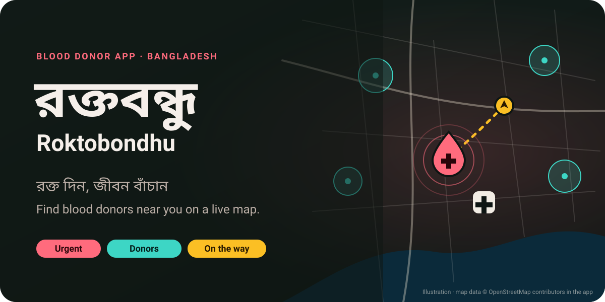

 

Free · no ads · voluntary donation only · Android 7.0 or newer · about 33 MB

  

     

**English** · [বাংলা](#বাংলা)

---

## What is Roktobondhu?

In Bangladesh, an urgent request for blood still travels by Facebook post, phone chain or an appeal at the hospital gate. Roktobondhu puts donors and requests on one live map, so a patient's family can find the nearest donor who can give, in minutes instead of hours.

A family posts what they need and where: blood group, how many bags, which hospital and by when. Nearby donors who can donate are alerted, and the search widens step by step until someone accepts. Once a donor says "I can donate", the family sees them on the way, can call them, and confirms the donation when it's done.

It is built privacy-first. Nobody sees where a donor lives, and phone numbers are shared only after a donor accepts.

> **This first release is a demo.** It runs on sample donors, hospitals and requests stored on your phone, so you can try every step without a server. See [Try the demo](#try-the-demo).

## Screenshots

<table>
  <tr>
    <td align="center">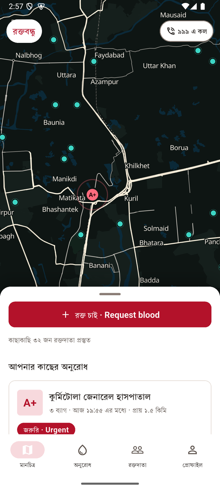 <b>Live map: donor areas and requests</b></td>
    <td align="center">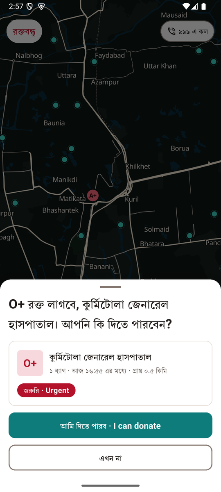 <b>Alert for a nearby request</b></td>
    <td align="center">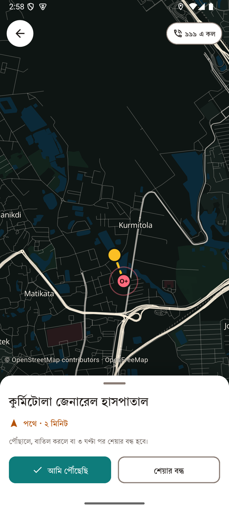 <b>On the way, sharing location</b></td>
  </tr>
  <tr>
    <td align="center">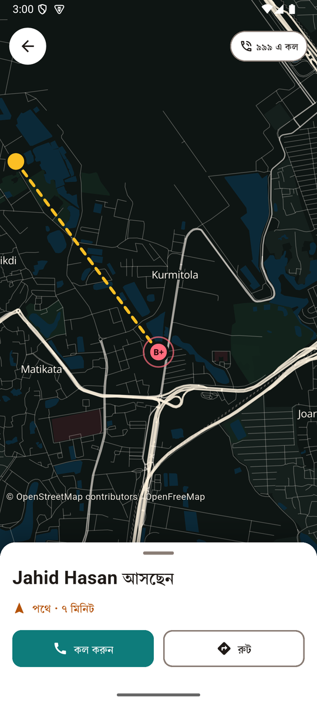 <b>The family sees the donor coming</b></td>
    <td align="center">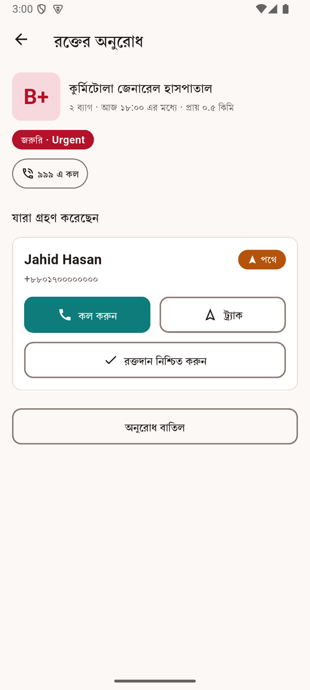 <b>Call, track, confirm the donation</b></td>
    <td align="center">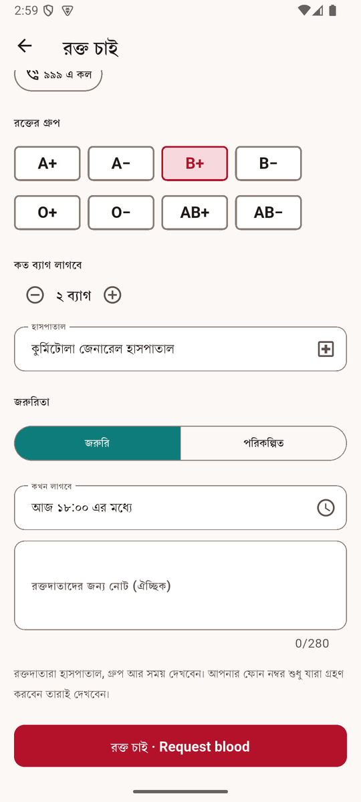 <b>Request blood in one screen</b></td>
  </tr>
  <tr>
    <td align="center">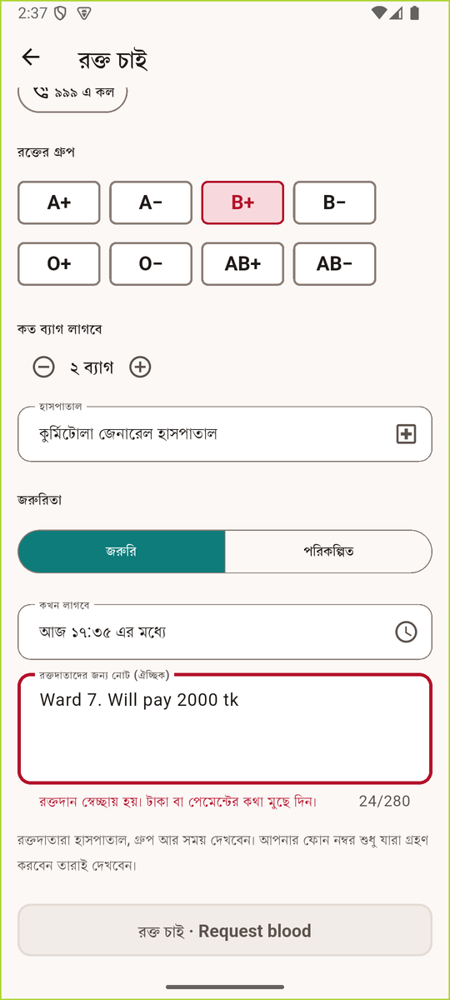 <b>Requests that mention money are blocked</b></td>
    <td align="center">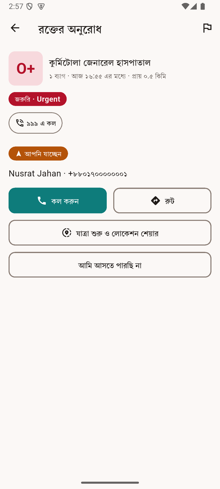 <b>Phone shared only after accept</b></td>
    <td align="center">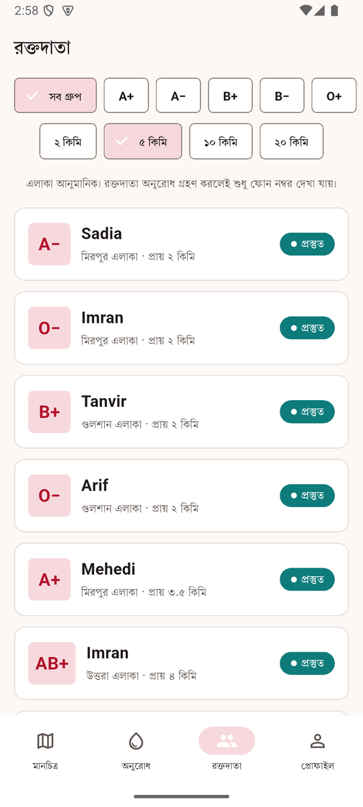 <b>Donors nearby, area only</b></td>
  </tr>
  <tr>
    <td align="center">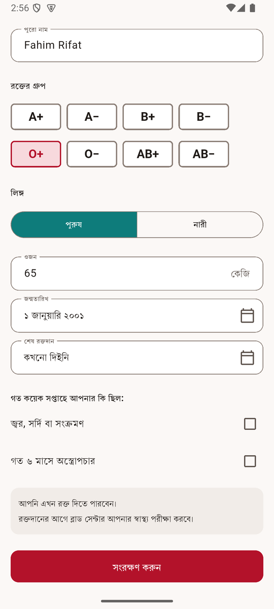 <b>Knows when you can donate</b></td>
    <td align="center">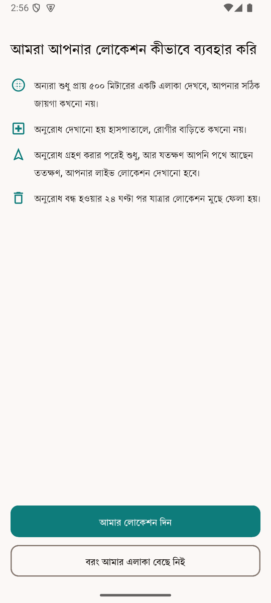 <b>Plain-language location consent</b></td>
    <td align="center">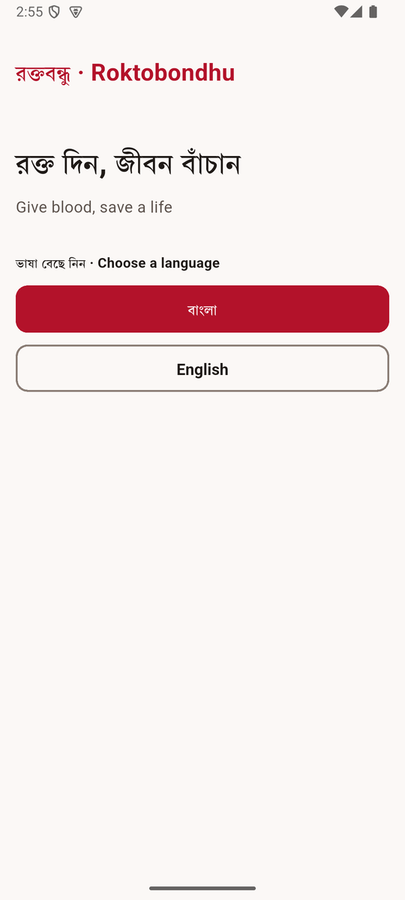 <b>Bangla or English</b></td>
  </tr>
  <tr>
    <td align="center">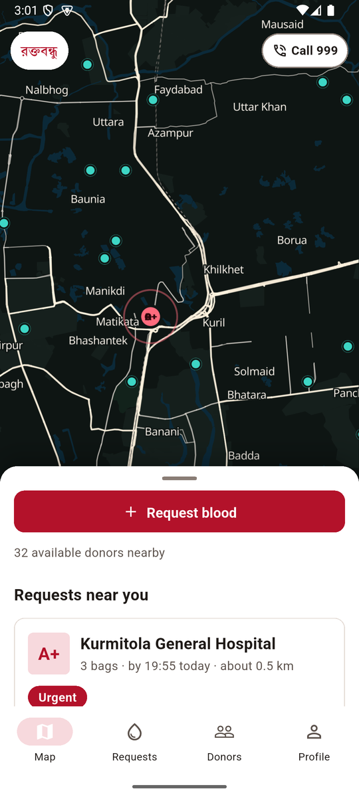 <b>Fully in English too</b></td>
    <td align="center">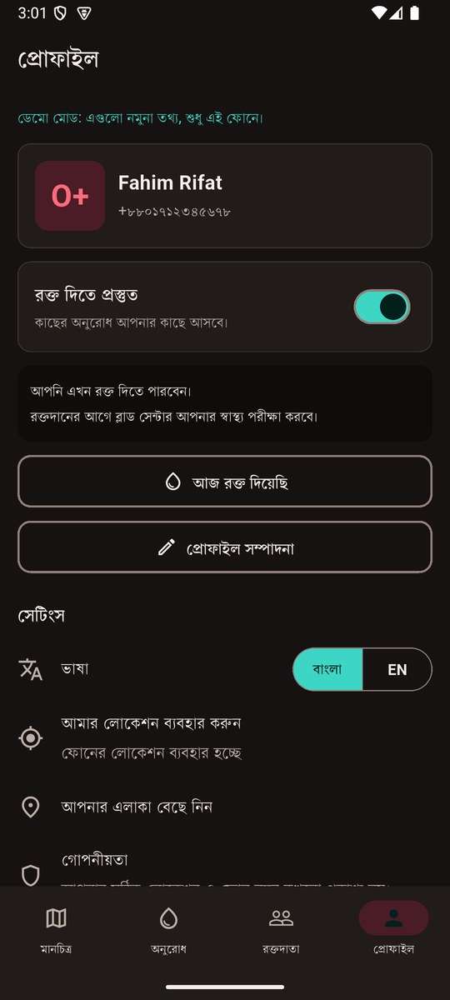 <b>Dark theme</b></td>
    <td align="center">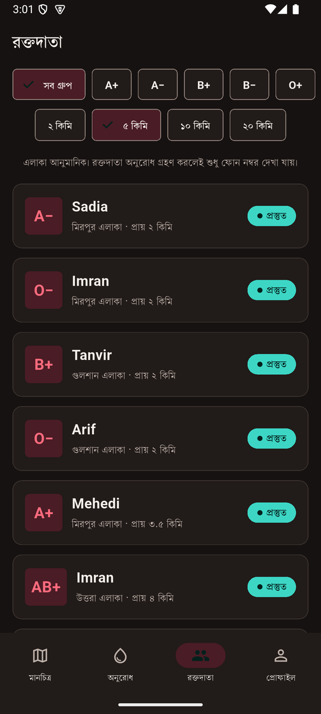 <b>Dark theme: donors</b></td>
  </tr>
</table>

## What's inside

| | |
|---|---|
| 🗺️ **Live map** | A dark OpenStreetMap map of Dhaka and Chattogram. Donors show as soft teal circles, requests as red drops at the hospital, and a donor on the way as an amber pin moving towards it. Switch on a satellite view with one tap. |
| 🩸 **Request blood** | Pick the blood group, number of bags, hospital, how urgent it is and when it's needed. Hospitals are listed nearest first, and you can search them in Bangla or English. |
| 🔔 **Alerts to the right donors** | Only donors whose blood group can be given, who are free and whose rest period is over are alerted. If nobody accepts, the search area grows from 2 km to 5, 10, 20 and 40 km. |
| 🚗 **On my way** | After accepting, a donor can share their live location until they arrive. The family sees the pin move and the minutes left. Sharing stops on arrival, on cancel, or after 3 hours. |
| 📞 **Call and route** | Once accepted, the donor and the family can call each other, and the donor gets directions to the hospital in their maps app. |
| ✅ **Confirm the donation** | The family confirms who donated. The donor's last donation date updates, and the app works out when they can give again. |
| 🗓️ **Knows when you can donate** | Enter your weight, date of birth and last donation, and the app tells you the date you can donate next: every 4 months for men, 6 for women. It never says you are medically fit; the blood centre checks that. |
| 👥 **Find donors for planned needs** | A list of donors nearby, filtered by blood group and distance, showing only their area and a rounded distance. |
| 🚨 **Call 999** | Every request screen has a shortcut to call 999 for a true emergency. |
| 🚫 **No money, ever** | Donation is voluntary. A request that mentions taka, payment, bKash or a reward is blocked, and you can report any request that looks fake or asks for money. |
| 🌐 **Bangla first** | The whole app works in Bangla or English, with Bangla digits in Bangla. Bangla text is set in **Purno**, the Bangla typeface from BCC, ICT Division, built into the app so it looks the same on every phone, even offline. Blood groups always read the same: O+, AB−. |
| 🌗 **Light and dark** | Follows your phone. The map stays dark in both, so the pins stand out. |

## Your privacy

| Who sees what | Before a donor accepts | After a donor accepts |
|---|---|---|
| Other donors | Nothing about you | Nothing |
| The family, about a donor | An area of about 500 m, no name or phone | Live position while on the way, name, phone |
| A donor, about the family | The hospital only, never a home | Route to the hospital, the family's phone |

Trip locations are deleted 24 hours after a request closes. If you don't allow location, the app works with an area you pick from a list.

## Try the demo

1. Open the app and choose **বাংলা** or **English**.
2. Enter any Bangladeshi mobile number and the code **`123456`**.
3. Fill in your profile and pick your area or allow location.
4. About 20 seconds later a sample request alert arrives. Tap **I can donate** to try the donor side.
5. Tap **Request blood** to try the family side. A sample donor accepts after a few seconds; open the request and tap **Track** to watch them travel to the hospital.

Nothing is sent to a server in the demo. Uninstalling the app removes the sample data.

## Install

1. Tap **Download now** above. The `roktobondhu.apk` file downloads to your phone.
2. Open the file when it finishes.
3. If Android asks about installing from an unknown source, tap **Settings**, turn on **Allow from this source**, go back and tap **Install**.
4. Open **Roktobondhu**.

> **Play Protect warning:** the app is not on Google Play yet and is signed with a development key, so Play Protect may call it unrecognised. Tap **More details › Install anyway**. Each release lists the SHA-256 of every file in `SHA256SUMS.txt` so you can check the download.
>
> **Older phone?** `roktobondhu.apk` is for 64-bit phones, which is almost every phone from 2017 onward. If it won't install, download `roktobondhu-<version>-armeabi-v7a.apk` (32-bit) or the larger `roktobondhu-<version>-universal.apk` from the [releases page](https://github.com/abdullah-al-faahim/Roktobondhu-releases/releases/latest).

## Questions

<b>Is this the real service?</b>

 

Not yet. This version is a demo with sample data on your phone. The live service, with real donors and hospitals, will start with a pilot in Dhaka together with blood clubs and hospitals that verify requests.

<b>Who can donate, and how often?</b>

 

The app follows guidance from Bangladesh blood transfusion departments: age 18 to 60, weight over 45 kg, and a gap of 4 months for men and 6 months for women between donations. Recent fever, a cold or an infection, or surgery in the last 6 months, means waiting. These are guides only; the blood centre always checks your health before you donate.

<b>Why does the map show circles instead of exact places?</b>

 

To keep donors safe. A donor's position is rounded to an area of about 500 m, and several donors in the same area are shown together. Their live location is shared only with the family whose request they accepted, and only while they're on the way.

<b>Can I pay or be paid for blood?</b>

 

No. Roktobondhu is for voluntary donation only. Requests that mention money are blocked, and anyone asking for or offering money can be reported and banned.

<b>Where does the map come from?</b>

 

© OpenStreetMap contributors, with vector tiles from OpenFreeMap. The optional satellite view is Sentinel-2 cloudless by EOX IT Services GmbH (2016 mosaic, CC BY 4.0).

## What's new

**0.1.1** sets Bangla in the Purno font, fixes the blank trip screen, makes the map smoother, keeps the Requests tab up to date, and shows area names in Bangla. If you have 0.1.0, uninstall it first, then install 0.1.1.

**0.1.0** was the first demo: live OpenStreetMap map, requests, alerts to donors, accept and live tracking, call and route, confirming a donation, the donor list and eligibility dates, in Bangla and English. See every version on the [releases page](https://github.com/abdullah-al-faahim/Roktobondhu-releases/releases).

---

## বাংলা

বিনামূল্যে · বিজ্ঞাপন নেই · শুধু স্বেচ্ছায় রক্তদান · অ্যান্ড্রয়েড ৭.০ বা নতুন · প্রায় ৩৩ এমবি

**রক্তবন্ধু** রক্তদাতা আর রোগীর পরিবারকে একটি লাইভ মানচিত্রে যুক্ত করে, যাতে কাছের যে রক্তদাতা এখন দিতে পারবেন, তাকে কয়েক মিনিটেই খুঁজে পাওয়া যায়।

- **রক্ত চাই:** রক্তের গ্রুপ, কত ব্যাগ, কোন হাসপাতাল আর কখন লাগবে, লিখে দিন।
- **ঠিক রক্তদাতার কাছে খবর:** যাদের গ্রুপ মেলে, যারা প্রস্তুত আর যাদের বিশ্রামের সময় শেষ, শুধু তাদেরই জানানো হয়। কেউ সাড়া না দিলে খোঁজার এলাকা ধাপে ধাপে বাড়ে।
- **পথে আছেন:** রক্তদাতা গ্রহণ করলে পরিবার দেখতে পায় তিনি কোথায়, আর কত মিনিট বাকি। পৌঁছালে, বাতিল করলে বা ৩ ঘণ্টা পর শেয়ার বন্ধ হয়।
- **কল ও রুট:** গ্রহণের পর দুই পক্ষ একে অপরকে কল করতে পারেন; রক্তদাতা হাসপাতালের রাস্তা পান।
- **আবার কবে দিতে পারবেন:** পুরুষ ৪ মাস, নারী ৬ মাস পরপর। অ্যাপ কখনো বলে না আপনি শারীরিকভাবে উপযুক্ত; সেটা ব্লাড সেন্টার পরীক্ষা করে।
- **গোপনীয়তা:** অন্যরা শুধু প্রায় ৫০০ মিটারের একটি এলাকা দেখে, ঠিকানা নয়। ফোন নম্বর দেখা যায় শুধু অনুরোধ গ্রহণের পর।
- **টাকার কথা নয়:** রক্তদান স্বেচ্ছায়। টাকা, পেমেন্ট বা বিকাশের কথা থাকলে অনুরোধ আটকে যায়।
- **জরুরি অবস্থায়:** প্রতিটি অনুরোধের পাতায় ৯৯৯ এ কল করার বোতাম আছে।

**ডেমো চালাতে:** যেকোনো বাংলাদেশি মোবাইল নম্বর আর কোড **`123456`** দিন। প্রায় ২০ সেকেন্ড পর একটি নমুনা অনুরোধ আসবে। এই সংস্করণে সব তথ্য নমুনা, শুধু আপনার ফোনে থাকে।

**ইনস্টল:** ওপরের বোতাম চেপে `.apk` ফাইলটি নামান, খুলুন, অ্যান্ড্রয়েড অনুমতি চাইলে **সেটিংস** থেকে "এই উৎস থেকে অনুমতি দিন" চালু করে **ইনস্টল** চাপুন। Play Protect সতর্ক করলে **আরও বিস্তারিত › তবুও ইনস্টল করুন** চাপুন; অ্যাপটি এখনো Google Play-তে নেই।

---

**রক্তবন্ধু · Roktobondhu** · made by **Abdullah Al Fahim**

Found a problem or have an idea? <a href="https://github.com/abdullah-al-faahim/Roktobondhu-releases/issues">Open an issue</a>.

